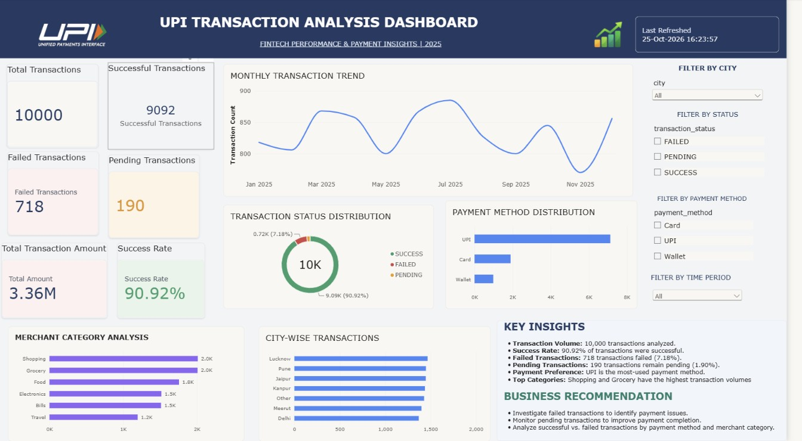

# UPI Fintech Transaction Analysis Dashboard

An end-to-end data analytics project analyzing 10,000 UPI transactions using Python, MySQL, and Microsoft Power BI.

## 📊 Dashboard Preview

## 🎯 Project Objectives

- Analyze UPI transaction performance and payment trends.
- Measure successful, failed, and pending transactions.
- Explore payment methods, merchant categories, and city-wise transaction patterns.
- Identify opportunities to improve transaction success rates.

## 📌 Key Performance Indicators

| Metric | Result |
|---|---:|
| Total Transactions | 10,000 |
| Successful Transactions | 9,092 |
| Failed Transactions | 718 |
| Pending Transactions | 190 |
| Transaction Success Rate | 90.92% |
| Total Transaction Amount | 3.36M |

## 🛠️ Tech Stack

- **Python:** Data analysis and data processing
- **MySQL:** Data storage and SQL queries
- **Microsoft Power BI:** Interactive dashboard and data visualization

## 📈 Dashboard Features

- KPI cards for key transaction metrics
- Monthly transaction trend analysis
- Transaction status distribution
- Payment method comparison
- Merchant category analysis
- City-wise transaction analysis
- Interactive filters for city, status, payment method, and time period

## 💡 Key Insights

- 10,000 transactions were analyzed.
- 90.92% of transactions were successful.
- 718 transactions failed, representing 7.18% of all transactions.
- 190 transactions remained pending, representing 1.90%.
- UPI is the leading payment method in the dashboard.
- Shopping and Grocery are among the leading merchant categories by transaction volume.

## 🚀 Business Recommendations

- Investigate failed transactions to identify potential payment issues.
- Monitor pending transactions to improve payment completion.
- Analyze failures by payment method and merchant category.
- Track transaction trends to support business decisions.

## 📁 Project Contents

- `README.md` — Project overview and dashboard preview
- `UPI_Fintech_Dashboard.jpg` — Power BI dashboard screenshot

*Additional Python scripts, SQL queries, and the Power BI report can be added to this repository as the project files are uploaded.*

## 👤 Author

**Asit Porwal**

Data Analytics | Python | SQL | Power BI
